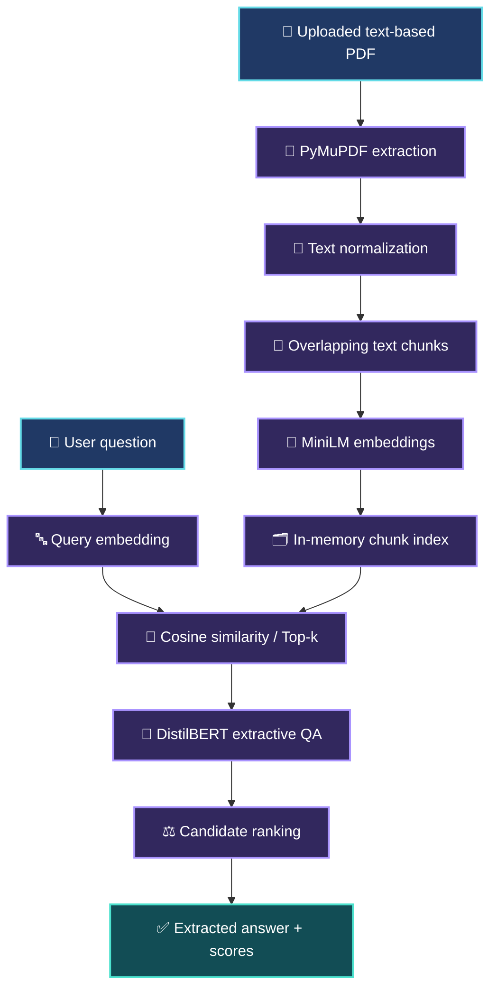
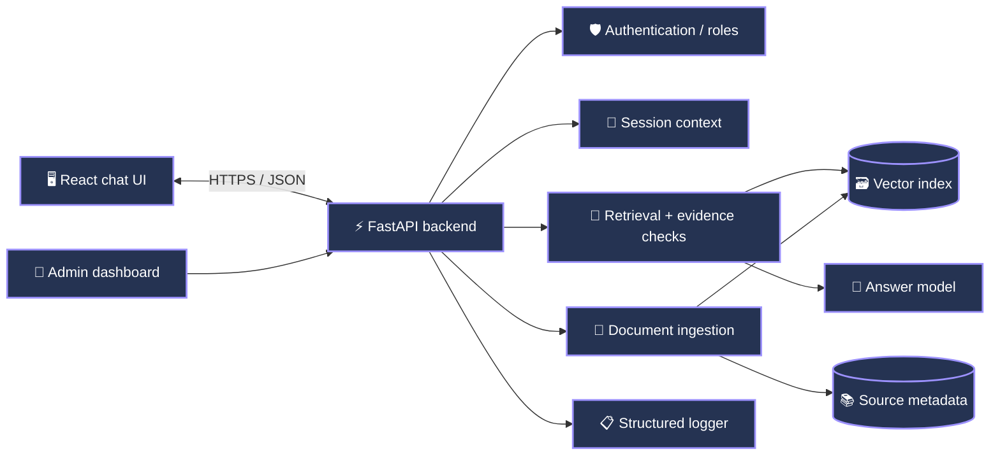

<div align="center">


# ContextIQ

### An AI-powered chatbot with document-grounded knowledge retrieval

**Turn your own knowledge base into useful, context-aware answers — with a clear path from a PDF question-answering prototype to a full-stack AI assistant.**

<p>
  
  
  
  
</p>


**[Overview](#-overview)** · **[Features](#-features-and-project-status)** · **[Architecture](#-system-architecture)** · **[Quick Start](#-getting-started)** · **[API Design](#-proposed-rest-api)** · **[Roadmap](#-development-roadmap)**

</div>

---

## ✨ Overview

**ContextIQ** is a knowledge-based AI chatbot project designed to answer questions using **only a user-provided collection of documents**, rather than relying on unrestricted external information.

The supplied implementation is a **Google Colab PDF question-answering prototype**. It extracts text from a PDF, prepares overlapping passages, converts those passages into semantic embeddings, retrieves relevant context for a question, and uses an extractive transformer model to select an answer.

The broader project goal is to build a complete application with a chat frontend, backend API, knowledge-base management, reliable out-of-scope handling, and optional user/admin capabilities.

> [!IMPORTANT]
> **Implementation status:** The included notebook is a working *research/prototype workflow*, **not yet a deployed chatbot application**. Features marked **Planned** below describe the target system, not code that is already implemented. In particular, the prototype does **not** currently guarantee refusal for unsupported questions.

### 🎯 Project objectives

- **Knowledge-focused responses:** Ground answers in uploaded documents instead of general web knowledge.
- **Intelligent retrieval:** Identify relevant passages with semantic similarity instead of depending only on keyword matches.
- **Graceful uncertainty:** Refuse or ask for clarification when sufficient document evidence is unavailable (**planned safeguard**).
- **Maintainable architecture:** Separate frontend, REST API, retrieval, models, and knowledge storage (**planned application structure**).
- **Expandable knowledge management:** Add, replace, and remove source files without retraining a foundational model (**planned persistent indexing**).

---

## 🚀 Features and project status

### Core requirements

| Requirement | Status | Details |
|:--|:--:|:--|
| Custom knowledge-base ingestion | 🟡 **Partial** | PDF text can be loaded and indexed in memory; multi-document, medium-scale persistence still needs implementation. |
| Accurate, knowledge-grounded answers | 🟡 **Partial** | Relevant PDF chunks are retrieved before extractive QA; strict evidence verification is not yet implemented. |
| Graceful handling of unknown questions | 🔴 **Planned** | Add retrieval thresholds, answer validation, clarification, and a reliable “not found” response. |
| Full chat frontend | 🔴 **Planned** | Build the interactive user-facing web interface. |
| Backend application and knowledge management | 🔴 **Planned** | Move notebook logic into services with persistent document and embedding storage. |
| Clean frontend-to-backend API | 🔴 **Planned** | Introduce versioned REST endpoints and structured responses. |
| GitHub project maintenance | 🟡 **Ready to organize** | This README and project files can be committed; repository history/CI must be maintained separately. |

### Additional capabilities

| Capability | Status | Notes |
|:--|:--:|:--|
| Semantic retrieval | 🟢 **Implemented** | Sentence Transformers embeddings + cosine similarity, top-3 passages by default. |
| PDF text extraction | 🟢 **Implemented** | PyMuPDF (`fitz`) reads text-based PDF files. |
| PDF cleanup and chunking | 🟢 **Implemented** | Text normalization and overlapping word chunks. |
| Extractive question answering | 🟢 **Implemented** | DistilBERT selects answer spans from retrieved text. |
| Confidence and relevance scoring | 🟡 **Prototype** | Combines QA score and similarity; score is **not calibrated** as a probability of correctness. |
| Short-term conversation memory | 🔴 **Planned** | Maintain context per session without treating chat history as a verified knowledge source. |
| TXT / HTML / web page ingestion | 🔴 **Planned** | Introduce format-specific loaders and normalization. |
| Incremental knowledge-base updates | 🔴 **Planned** | Update only affected document chunks and embeddings. |
| User and admin authentication | 🔴 **Planned** | Add access controls for chat and knowledge management. |
| API documentation | 🔴 **Design provided below** | Proposed endpoint contract; no server endpoints exist in the notebook. |
| Backend logging | 🔴 **Planned** | Request IDs, structured errors, ingestion events, and safe observability. |

**Legend:** 🟢 Implemented · 🟡 Partially implemented / prototype · 🔴 Planned

---

## 🧠 How the current AI pipeline works

The notebook uses **retrieval-augmented extractive question answering**. This is *not* foundation-model fine-tuning: new knowledge is represented as document chunks and embeddings, then used as context during inference.

1. **Upload a PDF** in Google Colab.
2. **Extract text** from each page with PyMuPDF.
3. **Clean text** by resolving line breaks, repeated symbols, and excessive whitespace.
4. **Split text into chunks** of approximately **180 words**, with an **overlap of 40 words**.
5. **Create embeddings** using `sentence-transformers/all-MiniLM-L6-v2`.
6. **Retrieve the top 3 chunks** using cosine similarity with the question embedding.
7. **Extract candidate answers** using `distilbert-base-cased-distilled-squad` over each retrieved passage.
8. **Rank candidates** with the notebook's weighted score and return the highest-ranked answer.

The current ranking formula is:

$$
\text{FinalScore} = 0.80 \times \text{QAScore} + 0.20 \times \text{CosineSimilarity}
$$

These weights are prototype settings, **not proof of answer reliability**. The QA model also truncates inputs to a maximum of 512 tokens, so very long contexts may lose information.

---

## 🏗 System architecture

### Current implementation



### Target full-stack architecture — planned



**Suggested technologies for the next phase:** React + Vite for the frontend, FastAPI + Pydantic for the REST service, FAISS or Chroma for persistent semantic search, and SQLite/PostgreSQL for document/user metadata. These are **architectural recommendations**, not dependencies used by the current notebook.

---

## 🛠 Technology stack

<div align="center">

| Layer | Current technology | Purpose |
|:--|:--|:--|
| Language | **Python 3** | Processing and orchestration |
| Development | **Google Colab / Jupyter** | Interactive prototyping |
| PDF parsing | **PyMuPDF** | Extract document text |
| Embeddings | **Sentence Transformers** | Create semantic vectors |
| Embedding model | **all-MiniLM-L6-v2** | Embed questions and passages |
| Question answering | **Hugging Face Transformers** | Extract relevant answer spans |
| QA model | **DistilBERT (SQuAD)** | Answer questions from context |
| Model execution | **PyTorch** | CPU/GPU model inference |
| Data processing | **NumPy + pandas** | Utilities and result tables |

</div>

The prototype uses pretrained, downloadable Hugging Face models. It does **not** require a paid language-model API key. An internet connection is needed to download model weights on first use.

---

## ⚙️ Getting started

### Prerequisites

- A Google account and access to **Google Colab** (recommended for this notebook).
- A text-based PDF document containing the information you want to query.
- Internet access for the first-time download of the pretrained models.
- Optional: a GPU runtime to accelerate model inference; CPU is also supported.

### Option A — Run the existing notebook in Google Colab (recommended)

**1.** Open [Google Colab](https://colab.research.google.com/) and import:

```text
notebooks/pdf_qa_prototype.ipynb
```

**2.** Set your preferred runtime under **Runtime → Change runtime type**. A GPU is optional.

**3.** Run the installation/import/model-initialization cells. The notebook includes an initial dependency installation cell, equivalent to:

```python
!pip install -q pymupdf sentence-transformers accelerate
```

**4.** At the **“Please upload the Easy PDF”** prompt, upload a PDF containing searchable text. Run the processing and retrieval cells after uploading it.

**5.** Run a question-answering cell, or use the interactive text-based loop:

```text
Enter your question: What does the document explain about ...?
Answer: <extracted passage>
Confidence: <model score>
```

Type `exit` to stop the interactive loop. The notebook also contains a separate **“Hard PDF”** evaluation path; when prompted, upload the other PDF to test noisier content.

> [!NOTE]
> The included notebook has been exported from the supplied Colab source, with saved outputs cleared and the `process_pdf()` function moved before its first call so cells can be executed in order. This preserves the original prototype logic.

### Option B — Install dependencies locally (for development)

Clone your repository (replace the placeholder with your actual GitHub URL):

```bash
git clone https://github.com/YOUR_USERNAME/YOUR_REPOSITORY.git
cd YOUR_REPOSITORY
python -m venv .venv
```

Activate the environment:

```bash
# macOS / Linux
source .venv/bin/activate

# Windows PowerShell
.venv\Scripts\Activate.ps1
```

Install packages:

```bash
python -m pip install --upgrade pip
pip install -r requirements.txt
```

**Local execution caveat:** The present notebook imports `google.colab.files` and uses Colab's upload dialog, so it is **not yet a standalone local CLI or web server**. For local Jupyter usage, replace the Colab upload code with a filesystem path and run the notebook in a compatible environment.

---

## 📁 Repository structure

The download accompanying this README contains the following **prototype** files:

```text
contextiq/
├── README.md                      # Project documentation
├── requirements.txt               # Python prototype dependencies
├── assets/
│   └── hero.gif                   # Local animated GitHub banner
└── notebooks/
    └── pdf_qa_prototype.ipynb     # Colab PDF question-answering notebook
```

**Suggested future folders (not included yet):** `frontend/`, `backend/`, `tests/`, `docs/`, and `data/`. Avoid committing uploaded private documents, secrets, or large downloaded model weights.

---

## 💬 Expected chatbot behavior

Once the full application and evidence safeguards are implemented, interactions should follow this principle:

| Situation | Desired response |
|:--|:--|
| Question is directly supported by the knowledge base | Answer concisely and cite the matching document/passage. |
| Question requires combining multiple passages | Answer only if the retrieved evidence supports the combination. |
| Question is ambiguous | Ask a brief clarification question. |
| No reliable matching document exists | “I couldn't find that information in the uploaded knowledge base.” |
| A document is deleted or updated | Use the current index; do not answer from obsolete content. |

> [!WARNING]
> These are **acceptance criteria for the planned chatbot**. The current notebook always attempts to return the highest-ranked answer and does **not yet enforce** a supported/unsupported distinction. A QA score alone should not be treated as evidence that the answer is correct.

### Proposed grounded-answer safeguards

1. Apply a tested retrieval-relevance threshold before calling the QA model.
2. Verify that the extracted answer appears in an authorized retrieved passage.
3. Return document identifiers, page numbers, and source snippets where available.
4. Use an explicit **out-of-scope** result when evidence is insufficient.
5. Evaluate thresholds using both answerable and unanswerable test questions; do not assume a universal threshold.
6. Keep session memory useful for understanding follow-up questions, without allowing memory to replace document evidence.

---

## 🔌 Proposed REST API

The following API contract documents the **planned backend**. These endpoints **do not exist in the current notebook** and are presented as the implementation target.

| Method | Endpoint | Purpose | Access |
|:--|:--|:--|:--|
| `GET` | `/api/v1/health` | API health check | Public |
| `POST` | `/api/v1/chat` | Submit a grounded question | User |
| `GET` | `/api/v1/sessions/{session_id}` | Retrieve session conversation | User (owner) |
| `POST` | `/api/v1/knowledge/documents` | Upload a supported document | Admin |
| `GET` | `/api/v1/knowledge/documents` | List indexed documents | Admin |
| `DELETE` | `/api/v1/knowledge/documents/{document_id}` | Remove document and index entries | Admin |
| `POST` | `/api/v1/knowledge/reindex` | Refresh changed knowledge | Admin |
| `POST` | `/api/v1/auth/login` | Authenticate a user | Public |

### Example: chat request

```http
POST /api/v1/chat
Content-Type: application/json
Authorization: Bearer <access_token>
```

```json
{
  "message": "What does the handbook say about leave requests?",
  "session_id": "example-session-123"
}
```

### Example: answer supported by a document

```json
{
  "status": "answered",
  "answer": "<answer extracted or generated from verified source text>",
  "session_id": "example-session-123",
  "sources": [
    {
      "document_id": "handbook-v1",
      "page": 12,
      "snippet": "<relevant source excerpt>"
    }
  ]
}
```

### Example: question outside the knowledge base

```json
{
  "status": "out_of_scope",
  "answer": "I couldn't find that information in the uploaded knowledge base.",
  "sources": []
}
```

**Documentation goal:** Use FastAPI's generated OpenAPI specification and interactive Swagger UI at `/docs` once the backend is implemented. Use validation schemas, versioned endpoints, standard error objects, and clear authentication requirements.

---

## 🧪 Testing and quality assurance

The notebook contains example questions, retrieval inspection, result tables, and tests against two uploaded PDFs, labeled **Easy PDF** and **Hard PDF**. Those are experiments, **not a formal automated test suite**.

### Suggested evaluation matrix

| Test category | What to check | Success criterion |
|:--|:--|:--|
| Direct factual query | Answer available in one passage | Answer supported by the passage |
| Multi-passage query | Information across passages | Evidence included for all claims |
| Out-of-scope query | No relevant material | Correct refusal / clarification |
| Contradictory documents | Conflicting source content | Do not invent a resolution |
| Updated document | Index modified | New information is retrievable |
| Deleted document | Index entry removed | Removed content is not retrieved |
| Session follow-up | Pronouns and context | Correct conversational reference |
| Unauthorized upload | Non-admin attempts upload | Request rejected |
| Empty/scanned PDF | No extractable text | Informative ingestion error |
| Large knowledge base | More files and chunks | Acceptable measured retrieval latency |

**Metrics to track after implementation:** retrieval Recall@k, answer exact match/F1 where appropriate, grounded-answer accuracy, refusal precision/recall, p50/p95 response latency, ingestion duration, and API error rate. No benchmark numbers are claimed for this prototype.

---

## 🗺 Development roadmap

- [x] PDF text extraction
- [x] Text cleaning and overlapping chunking
- [x] Sentence Transformer semantic embeddings
- [x] Top-k semantic retrieval
- [x] DistilBERT extractive question answering
- [x] Notebook evaluation on easy/hard PDF examples
- [ ] Robust out-of-scope and evidence verification
- [ ] Multi-document ingestion and persistent vector index
- [ ] Text and HTML/web-page ingestion
- [ ] Incremental insert/update/delete of knowledge-base documents
- [ ] Backend service with typed, documented REST APIs
- [ ] Responsive React chat frontend
- [ ] Session-based short-term conversation memory
- [ ] User/admin authentication and role-based permissions
- [ ] Request logging, monitoring, and safe exception handling
- [ ] Automated unit/integration tests and GitHub Actions CI
- [ ] Containerized deployment and production configuration

### Recommended milestones

**Milestone 1 — Grounding and reliability:** Document identifiers, source-page metadata, threshold tuning, unsupported-question detection, and automated QA tests.

**Milestone 2 — Full-stack MVP:** FastAPI endpoints, React chat UI, persistent vector search, environment configuration, and error handling.

**Milestone 3 — Administration:** Knowledge uploads/updates, role-based auth, session management, audit-friendly logging, and API documentation.

**Milestone 4 — Production readiness:** Integration tests, CI, rate limiting, secrets management, observability, deployment, and usability improvements.

---

## 🔒 Security and responsible knowledge handling

The target application should:

- Restrict document uploading, removal, and reindexing to authorized administrators.
- Enforce user/session access controls and avoid cross-user information disclosure.
- Store secrets in environment variables or secret managers, **never** in Git.
- Sanitize file names, validate file size/type, and limit ingestion resource usage.
- Treat document content as **untrusted data**; never execute instructions embedded in the knowledge base.
- Use careful logging that excludes passwords, bearer tokens, and sensitive source text.
- Provide clear deletion behavior for documents, vectors, and session data.

These protections are design requirements, not features already provided by the notebook.

---

## 🤝 Contributing and GitHub workflow

Contributions are welcome as the project moves from prototype to application. For a clean GitHub history, work in focused branches, document design decisions, and review changes through pull requests.

```bash
# Example workflow after you initialize your own GitHub repository
git checkout -b feature/grounded-fallback
git add .
git commit -m "feat: add grounded fallback policy"
git push -u origin feature/grounded-fallback
```

**Suggested commit prefixes:** `feat`, `fix`, `docs`, `test`, `refactor`, `chore`.

For privacy and repository size, add a `.gitignore` appropriate to your deployment and never publish PDFs you do not have permission to share.

---

## ❓ Frequently asked questions

**Does ContextIQ train a new language model?**  
Not currently. It indexes document content as embeddings and applies pretrained models for retrieval and extractive QA. This supports adapting to new documents without changing model weights.

**Can it answer only from uploaded knowledge?**  
That is the project goal. The current extractive pipeline uses retrieved PDF text, but unsupported questions may still produce plausible-looking answers. A proper abstention and evidence layer is part of the roadmap.

**Does it support multiple files and web pages?**  
Currently, the prototype processes a PDF at a time in memory. Multi-format, persistent, multi-file management is planned.

**Is there a frontend or REST API?**  
Not in the supplied notebook. The README defines a proposed architecture and API for the next development stage.

**Can it run without a GPU?**  
Yes. The notebook selects CUDA when available and otherwise uses the CPU; inference may take longer on CPU hardware.

**Can it read scanned/image-only PDFs?**  
Not reliably with the existing text extraction method. OCR would be a separate future enhancement.

---

## 📄 License

No open-source license has been selected for this project yet. Before public release, add an appropriate `LICENSE` file and update this section. A public GitHub repository **does not automatically grant reuse permissions**.

---

<div align="center">

### 🌌 ContextIQ — Ask your documents, not the internet.

*Building toward trustworthy, knowledge-grounded conversations.*


**⭐ If this project helps you, consider starring the repository.**

</div>
